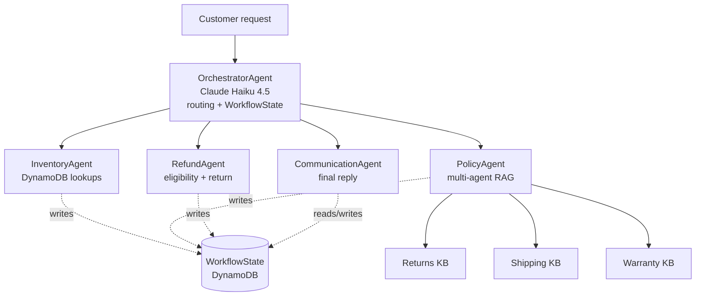
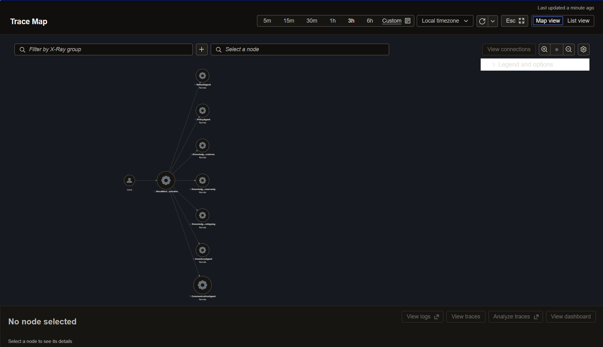

# NovaMart Multi-Agent Customer Support System

A production-style, multi-agent customer support system for a fictional e-commerce company, built with the **Strands Agents SDK** and **Amazon Bedrock AgentCore**. A single customer message is routed to specialist agents that look up orders, answer policy questions with parallel RAG, decide refund eligibility, and compose the final reply, with safety guardrails and full tracing.

> Built as part of Udacity's *Agentic AI on AWS* course. The course supplied the starter project (infrastructure template, helper modules, tests). The agent architecture in `src/agent_orchestrator.py` is my implementation.

## What it does

| Customer says | What happens |
|---|---|
| "I want to return my wireless headphones from order ORD-27176" | Inventory lookup, then refund decision (tier window enforced in code), then a customer-ready reply |
| "What is the return policy for premium customers?" | Three Knowledge Bases searched in parallel, results synthesized into one grounded answer |
| "How much would 5 items at $29.99 be with a 10% discount?" | Workers skipped; the Communication Agent calculates and rounds correctly ($134.96) |

## Architecture



- **Orchestrator** (Claude Haiku 4.5, temperature 0.0) classifies each request and calls worker agents as tools. It never writes the customer reply itself.
- **Workers** (Claude Sonnet 4.5) each own one domain: inventory, policy, refund, communication.
- **Models are configured, not hardcoded**: `config.ORCHESTRATOR_MODEL_ID` and `config.WORKER_MODEL_ID`.

### Routing rules enforced by the orchestrator prompt

1. Every request starts with `initialize_session`.
2. Order status, return and refund requests go to the inventory agent first, then the refund agent.
3. Policy questions (return windows, shipping rates, warranty terms) go to the policy agent.
4. Account questions ("what is my tier?") go to the inventory agent, never the policy agent, because policy documents hold no customer data.
5. Math questions skip the inventory, policy and refund agents.
6. Every request ends with the communication agent.

## Key design decisions

**Shared state with optimistic locking.** All agents write their findings to one DynamoDB `WorkflowState` record. Each update is a conditional write (`version = :expected_version`) that increments the version, so concurrent agents can't silently overwrite each other. On a conflict the update re-reads the current version and retries. A normal refund request moves the record from version 0 to 3 as the inventory, refund and communication agents write in turn.

**Business rules live in code, not in the prompt.** `initiate_refund` applies the return window (30 days Standard, 60 days Premium) against the order date, allows only `delivered` orders, calculates the refund as unit price x quantity, and writes the return with a conditional update so the same order can't be approved twice. The refund agent reports the tool's decision and can't approve or deny on its own.

**Parallel multi-agent RAG.** `search_all_policies` fans out to three retriever sub-agents (returns, shipping, warranty) with `ThreadPoolExecutor(max_workers=3)` and `as_completed()`, then combines the results. Each retriever answers only from its own Knowledge Base's passages and says so when there is nothing relevant.

**Grounded failure behavior.** If a policy lookup finds nothing or fails, the communication agent tells the customer it couldn't find the information and offers a human agent, instead of inventing a policy.

## AWS services

| Service | Role |
|---|---|
| Amazon Bedrock | Claude Haiku 4.5 and Sonnet 4.5 inference |
| Bedrock Knowledge Bases + S3 Vectors | Three KBs (returns, shipping, warranty), Titan Text Embeddings V2 (1024 dimensions), one S3 Vectors index each |
| Bedrock AgentCore Runtime | Hosts the deployed orchestrator (PUBLIC network, HTTP protocol) |
| Bedrock Guardrails | Input and output safety on every agent's model |
| AgentCore Memory | Session-summary memory resource, 7-day retention |
| DynamoDB | Orders, customers and WorkflowState tables |
| CloudWatch + X-Ray | Logs at INFO level; traces at 100% sampling |

### Guardrail policies

- **Content filters:** sexual, violence and hate at HIGH; insults and misconduct at MEDIUM
- **PII:** block credit card numbers and SSNs; anonymize emails and phone numbers
- **Denied topics:** competitor products, pricing negotiations, legal threats
- **Words:** managed profanity list
- Published as a numbered version, then attached to each agent's model through environment variables at runtime

## Observability

Every tool call is recorded as an X-Ray subsegment, so the Trace Map shows the full call chain: Client, orchestrator, the four worker agents, and one node per Knowledge Bases retrieval.



## Running it

The starter files (CloudFormation template, seed data, `config.py`, helper modules and tests) come from Udacity's course repo and are not included here. To run this project:

1. Get the course starter project and deploy `infrastructure/starter_stack.yaml` as the stack `udacity-agentcore` in `us-east-1`.
2. Seed the data: `python infrastructure/seed_data.py`
3. Create three Bedrock Knowledge Bases on the stack's S3 Vectors indexes (prefixes `policies/returns/`, `policies/shipping/`, `policies/warranty/`, Titan Text Embeddings V2 at 1024 dimensions) and sync each one. Put the IDs in `.env`.
4. Replace the starter's `src/agent_orchestrator.py` with the one in this repo.
5. Install dependencies and run locally:
   ```bash
   python -m venv venv && source venv/bin/activate    # Windows: venv\Scripts\Activate.ps1
   pip install -r requirements.txt
   python src/agent_orchestrator.py test
   ```
6. Deploy (needs Node.js 20+, `uv` and the AgentCore CLI `npm install -g @aws/agentcore@0.30.0`):
   ```bash
   python src/agent_orchestrator.py deploy
   python src/agent_orchestrator.py invoke "What is the return policy for premium customers?"
   ```

Approved returns change an order's status, so re-run `python infrastructure/seed_data.py` before repeating the refund scenario.

## Challenges and what I learned

- **Managed vs. vector-store Knowledge Bases.** My first KBs were created as "managed" KBs, which rejected the `vectorSearchConfiguration` the retrieval helper sends. Recreating them as standard KBs on the stack's S3 Vectors indexes fixed it. The lesson: read the actual error from a direct API call instead of trusting an agent's summary of it.
- **LLM arithmetic isn't deterministic.** The discount answer was sometimes rounded to whole dollars. Tightening the prompt (full precision, round half-up to cents at the end) made it consistent.
- **Keep side effects out of the model's hands.** Making eligibility, status checks and double-approval protection part of the tool, not the prompt, means the system behaves the same whatever the model says.
- **Parallel agents and terminal output.** Retriever sub-agents streaming at once garbled the console until their stdout streaming was turned off and their results were printed in order.

## Ideas for next steps

- Adversarial guardrail test suite (prompt injection, competitor and legal prompts) with documented results
- Wire AgentCore Memory into the orchestrator for recall across turns
- CloudWatch dashboard: invocations, latency per agent, guardrail interventions
- Authenticated front end (Cognito + a small web UI) in front of the runtime

## Project layout

```
src/agent_orchestrator.py   # all five agents, WorkflowState, guardrail, deploy, memory, observability
screenshots/                # X-Ray Trace Map and test results
README.md
```
- LinkedIn: https://www.linkedin.com/in/precious-adeniran-842b58294
- Email: adeniranprecious002@gmail.com
- GitHub: https://github.com/adeniranprecious002-ux# novamart-agentcore-support
